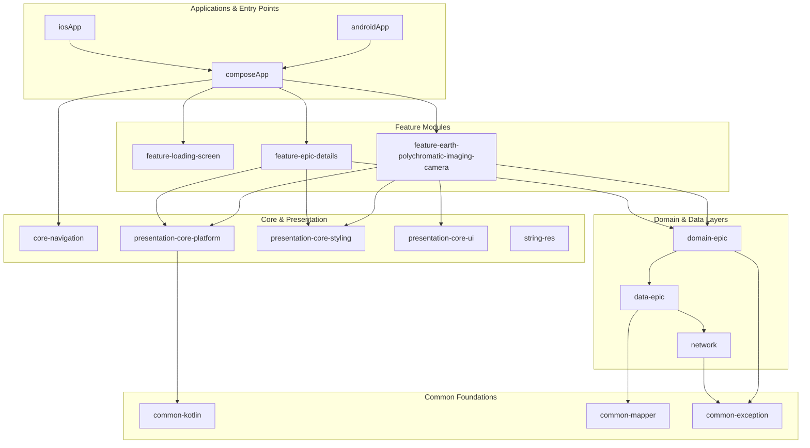

# CMP Architecture Playground 🚀

A modern, scalable **Kotlin Multiplatform (KMP)** and **Compose Multiplatform (CMP)** playground targeting **Android** and **iOS**. This repository demonstrates production-ready mobile architecture using modern Jetpack technologies, Unidirectional Data Flow (**MVI**), **Jetpack Navigation 3**, **Material 3 Adaptive Layouts**, **Koin Dependency Injection**, and **Clean Architecture** principles.

The sample feature in this project integrates NASA's **Earth Polychromatic Imaging Camera (EPIC)** API to showcase data fetching, reactive state management, list-detail adaptive navigation, and cross-platform UI rendering.

---

## 🛠 Tech Stack & Libraries

- **Language & Runtime**: [Kotlin 2.4](https://kotlinlang.org/) / Kotlin Multiplatform (KMP)
- **UI Framework**: [Compose Multiplatform 1.12](https://www.jetbrains.com/lp/compose-multiplatform/) (Declarative cross-platform UI)
- **Navigation**: [Jetpack Navigation 3 Multiplatform](https://developer.android.com/guide/navigation) (Type-safe key-based navigation, state preservation, `NavDisplay`)
- **Adaptive UI**: [Material 3 Adaptive](https://developer.android.com/develop/ui/compose/layouts/adaptive) (Two-Pane / List-Detail adaptive window size strategies)
- **Architecture**: Unidirectional Data Flow (MVI - Model-View-Intent) + Clean Architecture
- **Dependency Injection**: [Koin 4.1](https://insert-koin.io/) (KMP-compatible DI with ViewModel scoping)
- **Networking**: [Ktor Client 3.3](https://ktor.io/) (ContentNegotiation, Logging, Auth, Platform Engines for Android & iOS)
- **Image Loading**: [Coil 3.6](https://coil-kt.github.io/coil/) (Multiplatform Ktor integration)
- **Animation**: [Compottie 2.3](https://github.com/alexzhirkevich/compottie) (Cross-platform Lottie animation rendering)
- **Serialization**: `kotlinx.serialization` (JSON parsing & polymorphic navigation saved state)
- **Asynchronous Logic**: `kotlinx.coroutines` & `kotlinx.coroutines.flow`
- **Testing**: Kotlin Test, Mokkery (KMP Mocking), Robolectric, AndroidX Test Runner

---

## 📐 High-Level Architecture

The project follows a **Multi-Module Clean Architecture** combined with **Vertical Slicing** by feature. Dependencies strictly flow inward: `Feature/App` → `Domain` → `Data` → `Network/Core`.



---

## 📦 Module Breakdown

| Module Category | Module | Description |
| :--- | :--- | :--- |
| **Apps & Entry Points** | `composeApp` | Shared Compose Multiplatform UI root (`App.kt`, `NavigationRoot.kt`, Koin initialization). |
| | `androidApp` | Android application target launcher (`MainActivity.kt`, `CMPApplication.kt`). |
| | `iosApp` | iOS SwiftUI host wrapper app executing `MainViewController`. |
| **Features** | `feature-earth-polychromatic-imaging-camera` | EPIC NASA satellite imaging main list screen with MVI ViewModel. |
| | `feature-epic-details` | Detailed view for selecting specific satellite observations. |
| | `feature-loading-screen` | Splash/Loading screen feature powered by Compottie Lottie animations. |
| **Core & Navigation** | `core-navigation` | Navigation3 multiplatform setup, route keys, polymorphic serialization, and `TwoPaneScene`. |
| | `presentation-core-platform` | Base architecture foundation (`BaseMviViewModel`, MVI contracts, state management extensions). |
| | `presentation-core-styling` | Unified design tokens, theme system (`AppTheme`), colors, corners, typography. |
| | `presentation-core-ui` | Reusable cross-platform design components and state placeholders. |
| | `string-res` | Multiplatform localized string resources. |
| **Domain & Data** | `domain-epic` | Pure Kotlin business logic, Use Cases (`EPICDataListFlowUseCase`, `UpdateEPICUseCase`), domain models, and exception handling (`ResultLauncher`). |
| | `data-epic` | Repository implementations (`EPICRepositoryImpl`), network data sources (`EPICNetSource`), data mappers. |
| | `network` | Cross-platform Ktor HTTP client builder, timeout policies, logging, and engine configuration. |
| **Common Utilities** | `common-kotlin` | Shared Kotlin utilities and date formatting helpers (`CommonLocalDateFormat`). |
| | `common-mapper` | Base mapper contracts (`BaseMapper`) and reactive Flow transform extensions. |
| | `common-exception` | Unified exception taxonomy (`ApiException`, `ServerErrorApiException`, `ConnectionApiException`, `TimeoutApiException`). |
| **Build Logic** | `build-logic` | Gradle Convention Plugins (`AndroidFeatureConventionPlugin`, `KoinConventionPlugin`). |

---

## 🏛 Architecture Patterns & Key Highlights

### 1. Model-View-Intent (MVI) Architecture
The UI state management relies on explicit Unidirectional Data Flow using `BaseMviViewModel`:

- **ViewIntent**: User actions or lifecycle events emitted from the Composable UI.
- **PartialStateChange**: Internal state modifications reduced to form new `ViewState` snapshot.
- **ViewState**: Immutable state observed by Composable functions via `StateFlow`.
- **ViewEvent**: Single-shot side-effects (e.g., navigation events, toast messages).

```kotlin
internal class EPICViewModel(
    private val updateEPICUseCase: UpdateEPICUseCase,
    private val epicDataListFlowUseCase: EPICDataListFlowUseCase,
) : BaseMviViewModel<ViewIntent, ViewState, ViewEvent>() {

    override val viewState: StateFlow<ViewState>

    init {
        val initialState = ViewState()

        viewState = intentFlow
            .onStart { emit(ViewIntent.OnStartIntent) }
            .toPartialStateChange()
            .onEach { change ->
                change.toSingleEventOrNull()?.also { sendEvent(it) }
            }
            .scan(initialState) { state, change -> change.reduce(state) }
            .stateWhileSubscribed(viewModelScope, initialState)
    }
}
```

### 2. Multiplatform Navigation 3 & Adaptive Two-Pane Layout
Using **Jetpack Navigation 3** multiplatform primitives, routes are type-safe serializable `NavKey` instances:

- **Polymorphic Saved State**: Restores backstack state across platform lifecycle events.
- **Adaptive Scene Strategies**: Seamlessly toggles single-pane navigation on phones and side-by-side **Two-Pane** (`ListWithDetailsSceneStrategy`) on tablets or foldable devices.

```kotlin
NavDisplay(
    backStack = backStack,
    entryDecorators = listOf(
        rememberSaveableStateHolderNavEntryDecorator(),
        rememberViewModelStoreNavEntryDecorator(),
    ),
    sceneStrategies = listOf(
        ListWithDetailsSceneStrategy(
            windowClass = windowClass,
            empty = NavEntry(
                key = BaseNavigationDirection.EpicEmptyDetails,
                metadata = TwoPaneScene.twoPane(),
            ) { EmptyEpicDetails() }
        )
    ),
    entryProvider = { key ->
        when (key) {
            is BaseNavigationDirection.Epic -> NavEntry(key, metadata = TwoPaneScene.twoPane()) {
                EPICScreen { model -> backStack.addDetail(...) }
            }
            is BaseNavigationDirection.EpicDetails -> NavEntry(key, metadata = TwoPaneScene.twoPane()) {
                EpicDetailsScreen(identifier = key.identifier)
            }
            // ...
        }
    }
)
```

### 3. Unified Error Handling & Result Launcher
Data layer errors are caught and converted into a standard domain exception taxonomy:

```kotlin
suspend fun <T> resultLauncher(action: suspend () -> T): Result<T> = try {
    Result.success(action())
} catch (e: Exception) {
    Result.failure(handleException(e))
}

private fun handleException(cause: Throwable): BaseDomainException = when (cause) {
    is ApiException -> when (cause) {
        is ServerErrorApiException -> ServerException()
        is ConnectionApiException, is TimeoutApiException -> NetworkException()
        else -> UnknownException()
    }
    else -> UnknownException()
}
```

---

## 🚀 Getting Started

### Prerequisites
- **JDK 17** or higher
- **Android Studio** Ladybug (2024.2.1+) or newer (with Kotlin & Android SDK 37)
- **Xcode 15+** (for iOS builds, macOS only)

### Running on Android
Execute via Gradle wrapper or Android Studio target selector:
```bash
./gradlew :androidApp:assembleDebug
```
Or run directly onto an emulator/device from Android Studio by selecting `androidApp`.

### Running on iOS
1. Open `iosApp/iosApp.xcworkspace` or `iosApp/iosApp.xcodeproj` in Xcode.
2. Select your target simulator or physical device and click **Run**.

---

## 🧪 Testing

The codebase includes unit tests across domain and feature layers using **Kotlin Test** and **Mokkery**:

```bash
# Run unit tests across all common and target modules
./gradlew check
```

---

## 📄 License

This project is licensed under the MIT License - see the LICENSE file for details.
